# powkiddy-v90

Hand-written utilities, application replacements, and firmware tools for the **PowKiddy V90 / Q90** handheld running **MiyooCFW 1.3.3** (`320×240` 16-bit RGB565 display, Allwinner F1C100S `ARM926EJ-S`).

The PowKiddy V90 is a compact Linux device. While it is commonly used to play retro games, because it runs Linux (`uClibc-ng` + `SDL 1.2` + `ALSA`), you can write native C utilities controlled via the D-Pad, `A`/`B`/`X`/`Y`, `L1`/`R1`, `SELECT`, `START`, and `MENU` buttons.

Every application in this repository compiles both for the **PowKiddy V90 (`arm-miyoo-linux-uclibcgnueabi`)** and natively for **Linux Desktop (`x86_64` X11/SDL)** so you can test and debug on your workstation before copying the binaries to your MicroSD card.

---

## Included Applications & Tools

| Directory | Application | Replaces / Target on V90 | Desktop Binary |
| :--- | :--- | :--- | :--- |
| [`metronome/`](metronome/) | **Metronome** — Visual & audio beat timer with common time signatures | `/mnt/apps/metronome/metronome` | `metronome/metronome_linux` |
| [`pomodoro/`](pomodoro/) | **Pomodoro Timer** — Focus/break work timer with status display | `/mnt/apps/pomodoro/pomodoro` | `pomodoro/pomodoro_linux` |
| [`calc/`](calc/) | **Desk & Scientific Calculator (`BASIC` / `SCI`)** — High-contrast calculator with full `<math.h>` scientific functions | `/mnt/apps/calc/calc` | `calc/calc_linux` |
| [`bard/`](bard/) | **EPUB E-Book Reader** — Text-only `.epub` reader (`libzip` + `libxml2`) with chapter selector, light/dark themes, and whole-page scrolling | `/mnt/apps/bard/bard` | `bard/bard_linux` |
| [`videoplayer/`](videoplayer/) | **Native `320×240` Video Player** — Full-screen distraction-free video & ALSA audio player (`libavformat`, `libavcodec`, `libswscale`, `libswresample`) | `/mnt/apps/videoplayer/videoplayer` & `/mnt/gmenu2x/sections/applications/mplayer` | `videoplayer/videoplayer_linux` |
| [`chordwheel/`](chordwheel/) | **Circle of Fifths & Guitar Voicing Synth (`chordwheel`)** — Interactive Circle of Fifths, 6-string fretboard chord diagrams, and Karplus-Strong guitar synth | `/mnt/apps/chordwheel/chordwheel` | `chordwheel/chordwheel_linux` |
| [`pocketband/`](pocketband/) | **Pocket Drum Machine, Bassline & Backing Track Jam Buddy (`pocketband`)** — `4/4` & `3/4` Blues/Rock/Jazz drum + bass + chord backing band with 12-fret guitar soloing scale map | `/mnt/apps/pocketband/pocketband` | `pocketband/pocketband_linux` |
| [`fretboard/`](fretboard/) | **Interactive Guitar Fretboard, CAGED Scale, Chord & Arpeggio Reference (`fretboard`)** — 15-fret neck with 14 scales, 5 CAGED boxes, 12 chord qualities, Reverse Chord Finder, 6 tunings, and Karplus-Strong synth | `/mnt/apps/fretboard/fretboard` | `fretboard/fretboard_linux` |
| [`licktrainer/`](licktrainer/) | **Guitar Speed-Builder Practice Routine & Lick Coach (`licktrainer`)** — 25 exercises across 5 categories with 6-string tab, picking & fingerings, live 8-fret neck view, BPM speed ladder, and background Karplus-Strong synth | `/mnt/apps/licktrainer/licktrainer` | `licktrainer/licktrainer_linux` |
| [`sightread/`](sightread/) | **Guitar Staff-to-Fretboard Sight-Reading Trainer (`sightread`)** — Prominent 70% Treble Clef (`8vb`) staff with programmatic quarter/eighth-note pieces, non-interactive 12-fret position map, 5 neck positions, 7 keys, and background Karplus-Strong synth | `/mnt/apps/sightread/sightread` | `sightread/sightread_linux` |
| [`musicplayer/`](musicplayer/) | **Directory Music Player (`musicplayer`)** — Plays `.ogg`, `.flac`, and `.mp3` directories in filename order (`libvorbisfile`, `libFLAC`, `libmpg123`) with `/mnt/media` browser, `L1`/`R1` hold-to-seek, and persistent play-position resume | `/mnt/apps/musicplayer/musicplayer` | `musicplayer/musicplayer_linux` |
| [`eartrainer/`](eartrainer/) | **Guitar Interval & Chord Ear Trainer (`eartrainer`)** — 12 intervals & 12 chord qualities with 6-string fretboard visualizer, 3-guess flow, and Karplus-Strong guitar synth | `/mnt/apps/eartrainer/eartrainer` | `eartrainer/eartrainer_linux` |
| [`gmu/`](gmu/) | **Gmu Music Player (Keymap Fix & Port)** — Fixes swapped `A`/`B` & `X`/`Y` buttons on V90 and adds modern GCC desktop build support | `/mnt/apps/gmu/` | `gmu/gmu.bin` |
| [`patch_bootlogo/`](patch_bootlogo/) | **Boot Splash Patcher** — Replaces the embedded PNG inside `/mnt/boot-logo` on a `powkiddy-q90-v90-cfw-v1.3.3.img` image | `/mnt/boot-logo` inside `.img` | `patch_bootlogo/patch_boot_logo` |

---

## 1. [Metronome](metronome/)

A simple metronome that displays common time signatures and plays a tick on the beat. See [`metronome/README.md`](metronome/README.md) for build and SD card installation instructions.

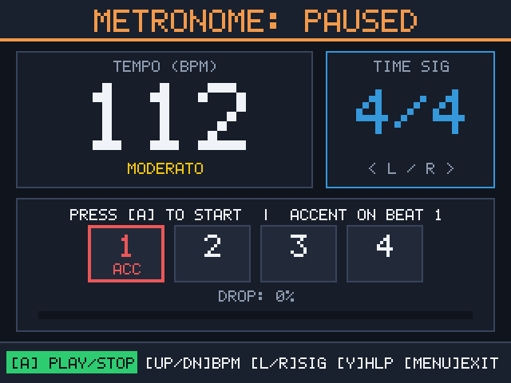

---

## 2. [Pomodoro](pomodoro/)

A work timer to track Pomodoro focus intervals and let folks know that you are working. See [`pomodoro/README.md`](pomodoro/README.md) for details.

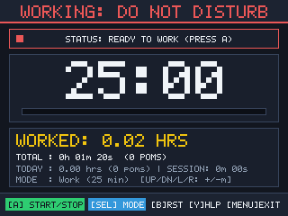

---

## 3. [Desk & Scientific Calculator (`calc`)](calc/)

A complete redesign and replacement for the stock `/mnt/apps/calc/calc` (`bittboy-calc`) application:
- **Edge-to-Edge High-Contrast UI**: Removes the stock calculator's wasted gray/black borders and small 12pt text in favor of a full-width `320×72` anti-aliased display (`30px` bold digits) and color-coded 3D beveled keycaps.
- **Basic (`BASIC`) & Scientific (`SCI`) Modes**: Press **`SELECT`** on the PowKiddy V90 (or **`Home`** / **`Esc`** on Linux desktop) to toggle between the 5×5 Basic keypad and the 5×8 Scientific keypad (`sin`, `cos`, `tan`, `asin`, `acos`, `atan`, `log`, `ln`, `exp`, `10^x`, `x^y`, `x^2`, `sqrt`, `cbrt`, `1/x`, `n!`, `mod`, `pi`, `e`, and `DEG`/`RAD` switching via `L1`).
- **Clean Exit**: Press **`START`** or **`MENU`** to quit.

See [`calc/README.md`](calc/README.md) for full controls, build instructions, and SD card deployment steps.

| Stock Firmware Calculator (`bittboy-calc`) | Upgraded Basic Mode (`BASIC`) | Upgraded Scientific Mode (`SCI`) |
| :---: | :---: | :---: |
| 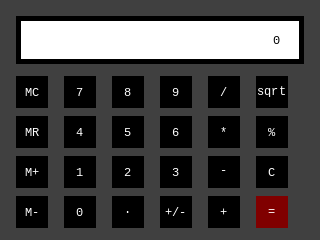 | 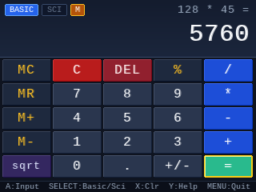 | 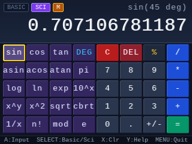 |

---

## 4. [EPUB E-Book Reader (`bard`)](bard/)

A fast C EPUB reader (`libzip` + `libxml2`) that replaces the stock `/mnt/apps/bard/bard` TTS reader:
- **Starts in `/mnt/media` & Remembers Last Reading Position**: Automatically saves the active book path, chapter, and page (`/mnt/.bard_state.cfg` on V90, `~/.bard_state.cfg` on desktop) when you exit and resumes from your exact page on the next launch. If the saved book path exists but the saved location does not, it opens the book to its first page; if the saved path does not exist, it opens the `/mnt/media` file selector.
- **Full-Screen Distraction-Free Reading**: Uses the entire `320×240` screen (`12` word-wrapped lines per page, zero horizontal scrolling, no automated scrolling) with a discrete **`Y: Help`** badge in the bottom-right corner.
- **Whole-Page Vertical Scrolling**: **`DPAD DOWN` / `UP`** scrolls one full page at a time.
- **Chapter Selector (`SELECT`)**: Lists all EPUB chapters (`toc.ncx` / EPUB 3 `<nav>`); navigate with **`DPAD UP` / `DOWN`** and press **`A`** to jump to a chapter.
- **Light & Dark Mode (`B`)**: Press **`B`** while reading to toggle between warm paper Light Mode and night-friendly Dark Mode.
- **Help & Progress Modal (`Y`)**: Displays the current chapter title, chapter & overall book page progress, and key mappings.

See [`bard/README.md`](bard/README.md) for full architecture, Linux package prerequisites, and PowKiddy V90 installation instructions.

| File Browser (`/mnt/media`) | Full-Screen Reading View (`Y: Help`) | Help & Progress Screen (`Y`) | Chapter List Overlay (`SELECT`) |
| :---: | :---: | :---: | :---: |
| 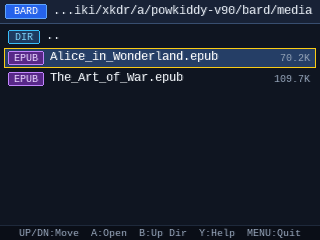 | 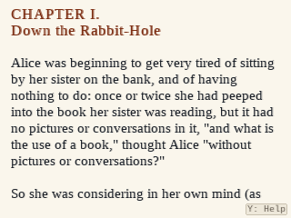 | 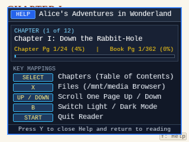 | 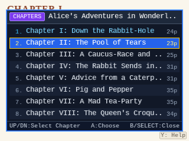 |

---

## 5. [Full-Screen Video Player (`videoplayer`)](videoplayer/)

A native `320×240` video and audio player built on FFmpeg (`libavformat`, `libavcodec`, `libswscale`, `libswresample`, `libavutil`) and ALSA (`libasound`) to replace the stock `/mnt/apps/mplayer` script:
- **Startup `/mnt/media` File Browser**: Opens `/mnt/media` on startup so you can pick a video file (`.mp4`, `.mkv`, `.avi`, `.webm`, `.mov`, `.mpg`) with **`DPAD UP` / `DOWN`** and **`A`**.
- **Distraction-Free Full-Screen Playback**: Renders `320×240` video across the entire screen with zero borders or status bars, synchronized to the ALSA hardware audio clock.
- **Pause & Device Help Overlay (`A`)**: Pressing **`A`** toggles play/pause and displays a translucent Device Help overlay with playback progress and button hints when paused.
- **Clean Exit (`START` / `MENU`)**: Pressing **`START`** or **`MENU`** exits immediately.

See [`videoplayer/README.md`](videoplayer/README.md) for desktop setup, `ffmpeg` transcoding commands, and SD card deployment instructions.

| `/mnt/media` File Browser | Full-Screen Video Playback (`320×240`) | Paused View with Device Help (`A`) |
| :---: | :---: | :---: |
| 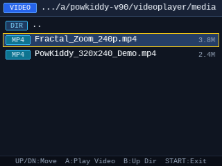 |  | 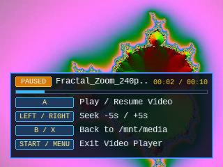 |

---

## 6. [Interactive Circle of Fifths & Guitar Synth (`chordwheel`)](chordwheel/)

An interactive Circle of Fifths, 6-string guitar chord voicing visualizer, and fixed-point Karplus-Strong plucked-string synthesizer designed for guitarists:
- **Interactive Circle of Fifths Wheel**: Shows all 12 Major keys (outer ring), 12 Relative Minor keys (inner ring), and `vii°` leading-tone diminished chords (center hub) with color-coded Tonic (`I/vi`), Subdominant (`IV/ii`), and Dominant (`V/iii`) diatonic windows.
- **6-String Guitar Fretboard Diagrams (`L1` / `R1`)**: Displays playable Open/CAGED, 6th-string E-shape barre, and 5th-string A-shape barre voicings for every Triad and 7th chord (`B` toggles Triads $\leftrightarrow$ 7th chords).
- **Karplus-Strong Guitar Strum (`A`) & 4-Bar Progression Looper (`X` / `Y`)**: Press **`A`** to hear the displayed 6-string guitar voicing strummed in real time, or queue a 4-chord progression loop.

See [`chordwheel/README.md`](chordwheel/README.md) for controls, build instructions, and SD card deployment steps.

| Key of C Major (`Triads`, Open `C`) | Key of G Major Locked (`7ths`, `Am7` 5fr E-Barre) | Key of F Major Auto-Loop (`Bb` A-Barre) | Help, Controls & Progression Looper (`Y`) |
| :---: | :---: | :---: | :---: |
| 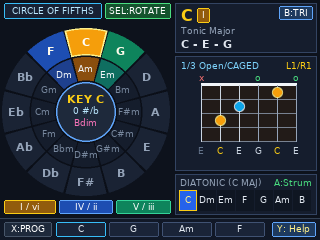 | 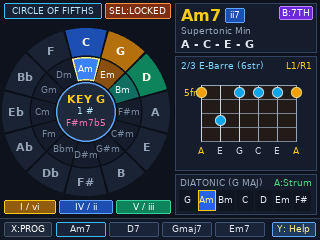 | 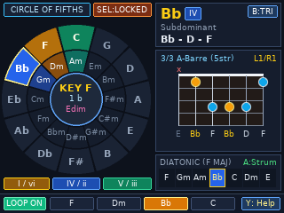 | 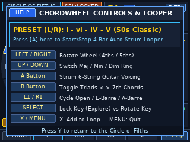 |

---

## 7. [Gmu Music Player Keymap Fix & Port (`gmu`)](gmu/)

Fixes the inverted face-button mappings in the stock MiyooCFW 1.3.3 Gmu Music Player (`A` $\leftrightarrow$ `B` and `X` $\leftrightarrow$ `Y` were swapped due to a Dingoo A320 keymap in `gmuinput.miyoo.conf`), reconstructs the Miyoo hardware backend ([`gmu/src/hw_miyoo.c`](gmu/src/hw_miyoo.c)), and updates the codebase to compile cleanly on modern desktop Linux GCC. See [`gmu/README.md`](gmu/README.md) for details.

| Playlist Browser (`B: Change play mode`) | Corrected V90 Help Screen (`Select + Up`) | Track Info & Spectrum Analyzer (`Start`) |
| :---: | :---: | :---: |
| 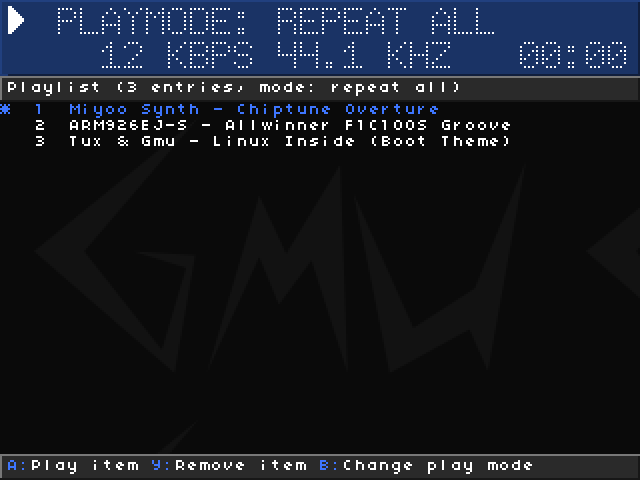 | 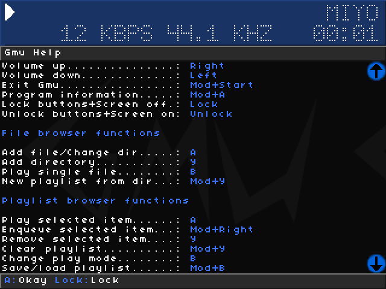 | 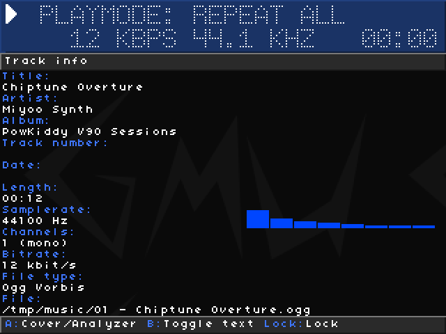 |

---

## 8. [Boot Splash Patcher (`patch_bootlogo`)](patch_bootlogo/)

A zero-dependency C99 utility ([`patch_bootlogo/patch_boot_logo.c`](patch_bootlogo/patch_boot_logo.c)) that encodes a custom `.bmp` image into an RGBA PNG in memory and patches the `/mnt/boot-logo` binary inside a `powkiddy-q90-v90-cfw-v1.3.3.img` disk image. See [`patch_bootlogo/README.md`](patch_bootlogo/README.md) for usage instructions.

| Stock Boot Splash (`Powkiddy®`) | Patched Boot Splash (`Linux inside`) |
| :---: | :---: |
|  |  |

---

## 9. [Guitar Interval & Chord Ear Trainer (`eartrainer`)](eartrainer/)

A guitar-focused ear-training application ([`eartrainer/eartrainer.c`](eartrainer/eartrainer.c)) featuring a 6-voice Karplus-Strong plucked-string synthesizer and a 12-fret 6-string fretboard visualizer:
- **Mode 1 — Interval Trainer (`INTERVALS`)**: Identifies all 12 intervals (`m2` through `P8`) in Ascending (`ASC`), Descending (`DESC`), Harmonic (`HARM`), or Mixed (`MIX`) styles across 3 difficulty tiers (`EASY`, `MEDIUM`, `ALL 12`).
- **Mode 2 — Chord Quality Trainer (`CHORDS`)**: Press **`SELECT`** to switch to identifying 12 guitar chord types (`Major`, `Minor`, `dim`, `aug`, `sus2`, `sus4`, `Dom7`, `Maj7`, `m7`, `m7b5`, `dim7`, `7sus4`).
- **3-Guess Flow & Fretboard Comparison (`X`)**: Gives you 3 tries per question before revealing the answer on the 6-string guitar neck, and lets you audition/compare any interval or chord from the same root note using **`X`**.

See [`eartrainer/README.md`](eartrainer/README.md) for full controls, build instructions, and SD card deployment steps.

| Interval Guessing (3 Tries) | Interval Answer & Fretboard Shape | Chord Quality Mode (`CHORDS`) | Lifetime Accuracy & Help (`Y`) |
| :---: | :---: | :---: | :---: |
| 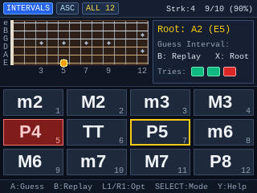 | 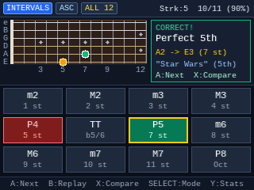 | 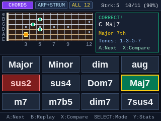 | 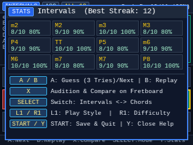 |

---

## 10. [Pocket Drum Machine, Bassline & Backing Track Jam Buddy (`pocketband`)](pocketband/)

A real-time drum machine, bassline sequencer, and chord-progression backing band ([`pocketband/pocketband.c`](pocketband/pocketband.c)) designed for guitarists:
- **Default Guitarist Jam View (`VIEW_JAM`)**: Launches immediately with the backing band playing, showing the current chord (`A7`, `Dm7`, etc.), next chord, 4-bar progression strip, live `1 & 2 & 3 & [4 &]` step LEDs, and a **12-fret 6-string guitar soloing scale map** highlighting key roots, active chord roots, and blue/color notes.
- **`4/4` & `3/4` Blues, Rock & Jazz Styles with Built-In Basslines**: Includes `Blues Shuffle 4/4`, `Slow Blues 3/4`, `Classic Rock 4/4`, `Rock Ballad 3/4`, `Jazz Swing 4/4`, and `Jazz Waltz 3/4`, with beat-and-`&` drum grids and transposing basslines (`R`, `3`, `5`, `6`, `b7`, `8`).
- **3-Way Backing Mix (`X`) & Step Editor (`SELECT`)**: Press **`X`** to cycle between `Full Band (Drums + Bass + Chord Stabs)`, `Drums + Bass`, and `Drums Only`, or press **`SELECT`** to customize drum hits and bassline notes.

See [`pocketband/README.md`](pocketband/README.md) for controls, build instructions, and SD card deployment steps.

| Guitarist Jam View (`Blues Shuffle 4/4`) | Step & Bassline Editor (`Classic Rock 4/4`) | `3/4` Waltz Jam View (`Jazz Waltz 3/4`) | Help & Groove Modal (`Y`) |
| :---: | :---: | :---: | :---: |
| 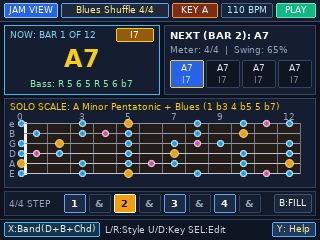 | 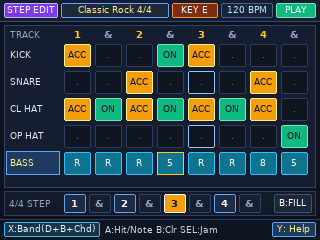 | 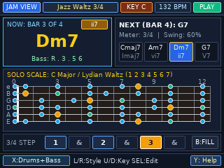 | 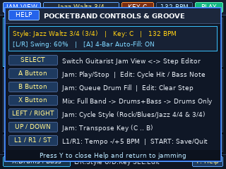 |

---

## 11. [Interactive Guitar Fretboard, CAGED Scale, Chord & Arpeggio Reference (`fretboard`)](fretboard/)

A full-neck 15-fret guitar reference ([`fretboard/fretboard.c`](fretboard/fretboard.c)) with a 6-voice Karplus-Strong guitar synthesizer:
- **Mode 1 — `SCALES & CAGED` (Default)**: Explore 14 essential guitar scales & modes across Frets `0–15` or isolated into the **5 CAGED positions** (`L1`/`R1` cycles `ALL NECK` $\leftrightarrow$ `POS 1..5`), with color-coded Root (Gold), Chord-Tone Skeleton (Green), Characteristic/Blue Note (Pink), and Scale Tone (Cyan) dots. Press **`A`** to hear the scale/box played ascending across the strings with a live fret indicator.
- **Mode 2 — `CHORDS & ARPEGGIOS`**: Inspect 12 chord qualities (`Major`, `Minor`, `7`, `maj7`, `m7`, `m7b5`, `dim7`, `sus2`, `sus4`, `add9`, `6`, `m6`) across **5 CAGED voicings up the neck** (`L1`/`R1`) overlaid on the full-neck arpeggio map, and press **`A`** to strum.
- **Mode 3 — `FRET EXPLORER` (Reverse Chord & Note Finder)** & **6 Alternate Tunings (`Y`)**: Move a cursor across any string & fret to see its exact pitch (`F#3`), frequency (`185.0 Hz`), and interval, or lock notes with **`B`** to automatically identify custom chords (`Em(add9)`, `G/B`, etc.). Supports `Standard`, `Drop D`, `Eb Standard`, `D Standard`, `DADGAD`, and `Open G` tunings.

See [`fretboard/README.md`](fretboard/README.md) for controls, build instructions, and SD card deployment steps.

| Scales & CAGED Box View (`A Blues`, `POS 1`) | Chords & Arpeggios View (`Cmaj7`, `Voicing 2`) | Fret Explorer & Reverse Chord Finder (`Em(add9)`) | Help & 6 Guitar Tunings Modal (`Y`) |
| :---: | :---: | :---: | :---: |
|  |  |  |  |

---

## 12. [Guitar Speed-Builder Practice Routine & Lick Coach (`licktrainer`)](licktrainer/)

A hands-free guitar technique coach, 6-string tab player, and automated BPM speed-builder ([`licktrainer/licktrainer.c`](licktrainer/licktrainer.c)):
- **25 Built-In Guitar Exercises Across 5 Categories (`L1` / `R1` for Category, `LEFT` / `RIGHT` for Lick)**:
  1. **`PENTATONIC` (`#01`–`#05`)**: *Gilbert 4-Note Seq*, *Eric Johnson 5s*, *Pentatonic Threes (12/8)*, *Wide String Skip*, and *Box 1-to-2 Slide*.
  2. **`LEGATO/ARP` (`#06`–`#10`)**: *Legato 3-NPS Roll*, *Minor Triad Arp*, *Min7 Skipped Arp*, *Dim7 Symmetry Arp*, and *5-Str Sweep Shape*.
  3. **`ALT PICK` (`#11`–`#15`)**: *Gilbert 3-NPS Cell*, *Neoclassic Pedal*, *Diatonic 4-Note*, *Di Meola Syncopa*, and *Cross-String Jump*.
  4. **`BLUES/ROCK` (`#16`–`#20`)**: *BB & Albert Turn*, *SRV Texas Shuffle*, *Dorian Mixo Run*, *Hendrix Chord Embl*, and *Blues b5 Cascade*.
  5. **`SPIDER` (`#21`–`#25`)**: *1-2-3-4 Spider*, *1-3-2-4 Permute*, *Skipping Spider*, *Diagonal Spider*, and *4-3-2-1 Pinky Work*.
- **6-String Guitar Tab (`e B G D A E`) + Live 8-Fret Neck View**: Shows picking/articulation directions (`D`, `U`, `H`, `P`, `/`) above the staff, left-hand finger numbers (`1–4`) below the staff, and a zoomed 8-fret guitar neck highlighting the full lick shape and active note.
- **Automated BPM Speed-Builder Ladder (`X`) & Background Karplus-Strong Synth (`B`)**: Pre-synthesizes every step's plucked/legato string audio in a dedicated background thread (`synth_worker_thread_fn`) with atomic preemption so the UI stays 100% responsive.

See [`licktrainer/README.md`](licktrainer/README.md) for controls, build instructions, and SD card deployment steps.

| Pentatonic Licks (`#05` Box 1 to 2 Slide) | Legato & Arpeggios (`#10` 5-Str Sweep) | Warmup & Spider (`#21` 1-2-3-4 Spider) | Controls & Practice Guide (`Y`) |
| :---: | :---: | :---: | :---: |
| 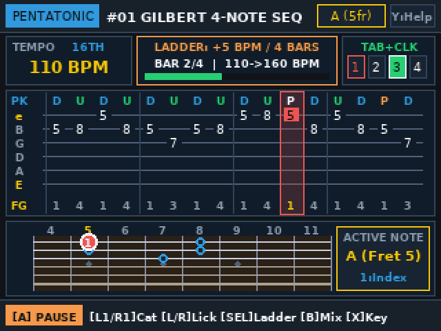 | 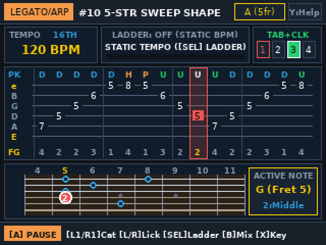 | 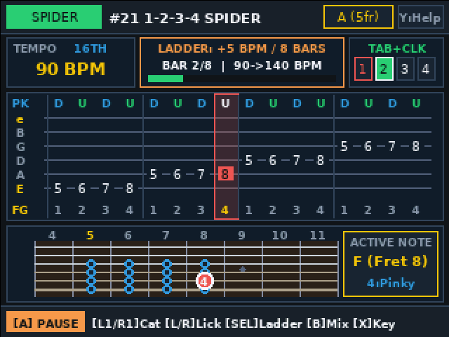 | 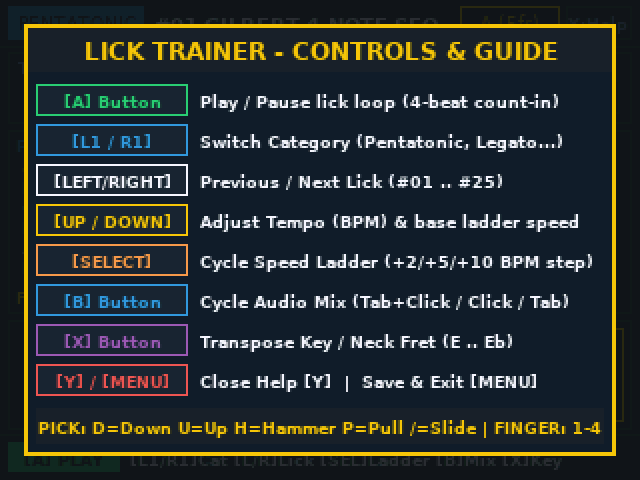 |

---

## 13. [Guitar Staff-to-Fretboard Sight-Reading Trainer (`sightread`)](sightread/)

A dual-view guitar sight-reading trainer ([`sightread/sightread.c`](sightread/sightread.c)) designed to connect standard `8vb` guitar treble notation to positions on the neck:
- **Prominent Interactive Treble Clef Staff — Top 70% of the Screen (`y: 24..164`)**: Displays a 2-measure `4/4` musical piece with mixed quarter notes and beamed eighth-note pairs, ledger lines (`E2`–`E5`), and key signature sharps/flats. Use **`LEFT` / `RIGHT`** to move the highlight cursor across the staff, **`B`** to play the single highlighted note, or **`A`** to play/pause the entire piece.
- **Non-Interactive 12-Fret Guitar Neck Reference — Bottom 30% (`y: 166..215`)**: Shows all note positions used in the piece strictly constrained to the active **Neck Position** (`OPEN (0-4fr)`, `POS 2 (2-5fr)`, `POS 5 (5-8fr)`, `POS 7 (7-10fr)`, `POS 9 (9-12fr)` via **`SELECT`**) and brightly highlights the currently selected/playing staff note with its left-hand finger (`0–4`).
- **Programmatically Generated Progressive Exercises (`L1` / `R1`) & Background Karplus-Strong Synth**: Deterministically generates `EX #01..#99` across 4 progressive difficulty levels (`LVL1`–`LVL4`) and 7 key signatures (`X`), with all guitar string synthesis running on a dedicated background worker thread (`synth_worker_thread_fn`).

See [`sightread/README.md`](sightread/README.md) for controls, build instructions, and SD card deployment steps.

| Open Position (`EX #01 LVL1`, `C Maj`) | 5th Position (`EX #07 LVL2`, `G (1#)`, Playing) | 7th Position (`EX #16 LVL4`, `D (2#)`) | Controls & Guide (`Y`) |
| :---: | :---: | :---: | :---: |
| 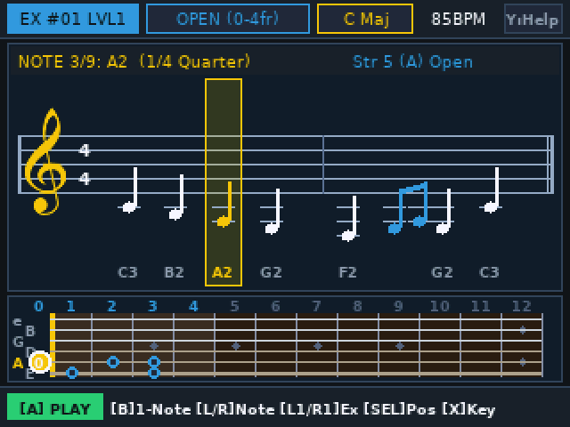 | 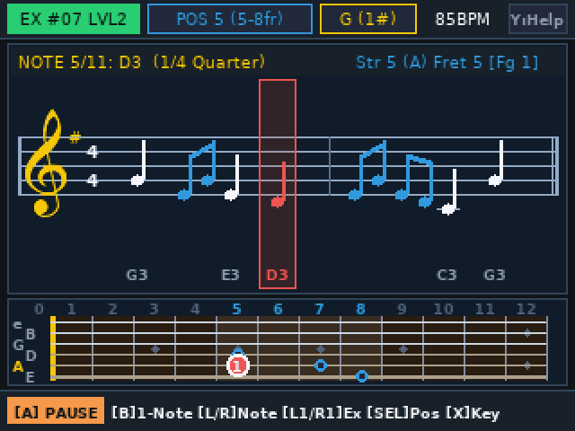 | 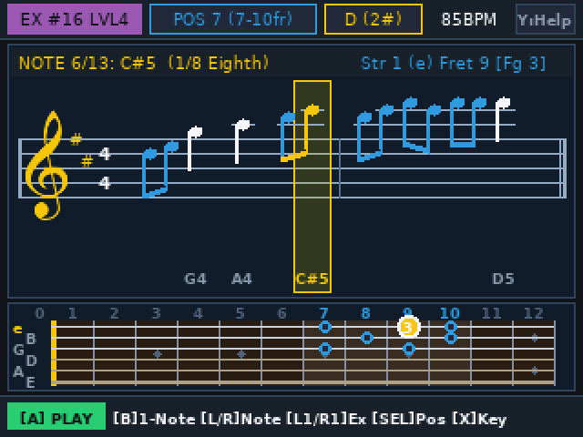 | 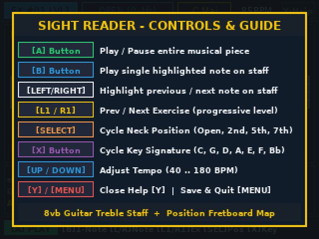 |

---

## 14. [Directory Music Player (`musicplayer`)](musicplayer/)

A distraction-free `.ogg`, `.flac`, and `.mp3` directory music player ([`musicplayer/musicplayer.c`](musicplayer/musicplayer.c)) powered by **`libvorbisfile`**, **`libFLAC`**, and **`libmpg123`** on a background decoder thread:
- **Opens to `/mnt/media` Directory Browser with `[RESUME]` at the Top**: Highlights the saved session (`[RESUME] <Directory>/<Track> (MM:SS)`) at index 0 when returning to the app, and lists directories with track counts. Selecting a directory with **`A`** loads all `.mp3`, `.ogg`, and `.flac` files in filename order and begins playback.
- **Interactive Playlist (`UP`/`DOWN` + `B`) & Global Hold-to-Seek (`L1`/`R1`)**: In the Now Playing + Playlist view, **`A`** toggles Play/Pause, **`UP`/`DOWN`** moves the highlight cursor across the playlist, and **`B`** starts playing the highlighted song. **`L1`/`R1`** seeks backward/forward (hold to rewind/fast-forward) in both the Player view and the Directory Browser view.
- **Persistent Playlist & Play Position (`MENU` to Quit, `Y` for Help)**: Pressing **`MENU`** saves the active file list and exact playback position (`position_ms`) to `/mnt/apps/musicplayer/musicplayer.cfg` (or `~/.musicplayer.cfg` on desktop).

See [`musicplayer/README.md`](musicplayer/README.md) for controls, build instructions, and SD card deployment steps.

| `/mnt/media` Directory Browser (with `[RESUME]`) | Now Playing (`FLAC`) & Playlist (`UP`/`DOWN` + `[B]`) | Ogg Vorbis (`OGG`) Playback | Controls & Guide (`Y`) |
| :---: | :---: | :---: | :---: |
| 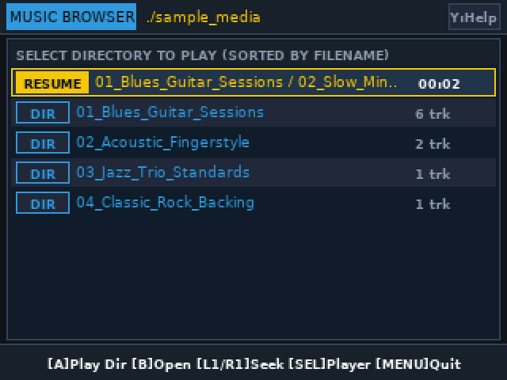 | 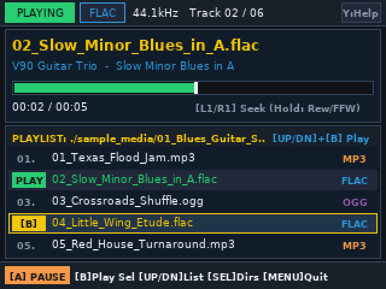 | 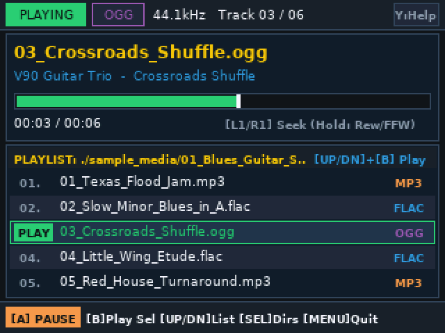 | 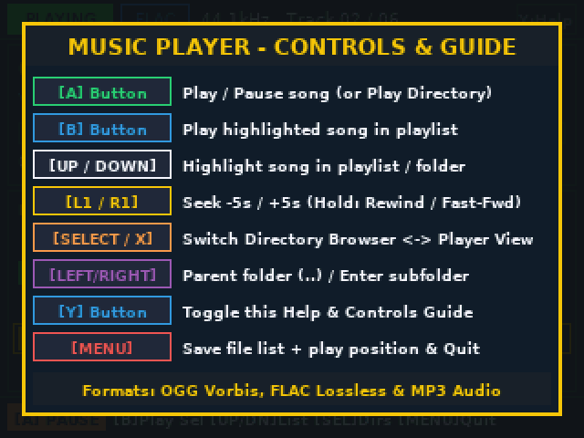 |

