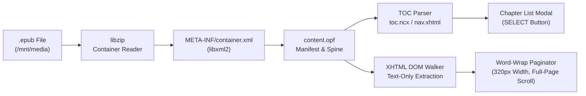

# PowKiddy V90 EPUB Reader (`bard` Replacement)

A lightweight, fast C EPUB & text e-book reader (`bard.c`) designed to replace the stock `/mnt/apps/bard/bard` reader on the **PowKiddy V90 / Q90** running **MiyooCFW 1.3.3** (320×240 16-bit display, Allwinner F1C100S `ARM926EJ-S`), with a native **x86_64 Linux (`X11`)** target (`bard_linux`) for desktop reading and debugging.

---

## Screenshots

| File Browser (`/mnt/media`) | Full-Screen Reading View (`Y: Help`) | Help & Progress Screen (`Y`) | Chapter List Overlay (`SELECT`) |
| :---: | :---: | :---: | :---: |
|  |  |  |  |

---

## 1. Design of the Application

### Why Replace the Stock `apps/bard/bard` Reader?
Reverse-engineering the stock `/mnt/apps/bard/bard` binary (3.2 MB unstripped ARM ELF from `Bard Storyteller`) revealed why it was poorly suited for reading EPUB books on the PowKiddy V90:
- **Built as a Text-to-Speech (TTS) Audiobook Player**: Over 2.9 MB of the binary was CMU Flite US English speech synthesis data (`flite/lang/usenglish/*`), and its reading view was built around continuous **automated scrolling** (`bard_text_scroll`) and word-by-word TTS token highlighting (`bard_window_token_highlight_move`).
- **No Chapter List / Table of Contents**: Stock `bard` concatenated all EPUB spine entries into a single stream without parsing `toc.ncx` or EPUB 3 `<nav>` documents, providing no way to view or jump to chapters.
- **No `/mnt/media` Startup Picker & Legacy Keymap**: Did not open directly into `/mnt/media` and used Dingoo/GCW-Zero button assignments.

### Architecture & EPUB Processing Pipeline



1. **Standard EPUB Libraries (`libzip` + `libxml2`)**:
   - Both **`libzip.so.5`** (`libzip.so.5.0`) and **`libxml2.so.2`** (`libxml2.so.2.9.7`) are pre-installed in `/usr/lib` on the PowKiddy V90 root filesystem and in the MiyooCFW SDK sysroot.
   - `zip_open()` and `zip_fopen_index()` read compressed entries directly from the `.epub` OCF container in memory without extracting temporary files to the SD card.
   - `xmlReadMemory()` / `htmlReadMemory()` parse:
     - `META-INF/container.xml` to locate the `<rootfile full-path="..."/>` (`.opf` package document).
     - The `.opf` `<metadata>` (`dc:title`, `dc:creator`), `<manifest>` (`id` $\rightarrow$ `href`, `media-type`, `properties`), and `<spine>` (`<itemref idref="..."/>` reading order).
     - **EPUB 2 NCX (`toc.ncx` `<navMap>/<navPoint>`)** and **EPUB 3 Navigation Documents (`<nav epub:type="toc">`)** to populate the interactive **Chapter List** (with automatic fallback to extracting the first `<h1>`–`<h4>` / `<title>` heading from each spine item if an EPUB omits a TOC).
2. **Text-Only Extraction (Images Ignored)**:
   - Walks the XHTML DOM tree (`walk_xhtml_nodes()` in [`bard.c`](bard.c)) and explicitly ignores `<head>`, `<style>`, `<script>`, ``, `<svg>`, `<image>`, `<audio>`, and `<video>` elements.
   - Extracts clean headings (`<h1>`–`<h4>`) and paragraphs (`<p>`, `<div>`, `<li>`, `<blockquote>`, `<pre>`), decoding XML/HTML entities (`&mdash;`, `&ldquo;`, `&rsquo;`, `&nbsp;`, `&amp;`, numeric entities) and normalizing UTF-8 punctuation.
3. **Word-Wrapped Layout (Zero Horizontal Scrolling)**:
   - Renders proportional anti-aliased serif book typography (`LiberationSerif-Regular.ttf` in [`bard_font.h`](bard_font.h)) with `12 px` left and right margins (`296 px` text column on the `320×240` screen).
   - Every paragraph is wrapped using exact per-glyph pixel advance widths; words wider than `296 px` are split at the margin so **horizontal scrolling never happens**.
4. **Full-Screen Reading Canvas & Static Whole-Page Vertical Scrolling**:
   - To maximize reading space on the compact `320×240` LCD, the reading view uses the **entire `320×240` screen** (`12` lines per page, `LINES_PER_PAGE = 12`) with no top or bottom bars, placing only a discrete **`Y: Help`** badge in the bottom-right corner.
   - There is **no automated scrolling**. Pressing **`DPAD DOWN`** advances **one whole page** forward (moving to Page 1 of the next chapter at the end of a chapter); pressing **`DPAD UP`** moves **one whole page** backward.
5. **Help & Reading Progress Screen (`Y` Button)**:
   - Pressing **`Y`** (`Space` on V90 / `Y` or `H` on Linux desktop) opens the **Help & Progress** overlay, displaying:
     - **Chapter Name**: Current chapter index and full chapter title (`Chapter X of Y`).
     - **Current Progress**: Current page within the chapter (`Chapter Pg X/Y`), overall page and percentage across the entire book (`Book Pg A/B`), and a visual progress bar.
     - **Key Mappings**: `SELECT` (Chapters), `X` (Files), `UP / DOWN` (Scroll Page), `B` (Switch Light / Dark Mode), and `START` (Quit).
6. **Chapter Selection Modal (`SELECT` + `DPAD UP/DOWN` + `A`)**:
   - Pressing **`SELECT`** opens the **CHAPTERS** overlay listing all chapters in the EPUB along with each chapter's page count.
   - **`DPAD UP` / `DPAD DOWN`** moves the selection highlight across chapters, and pressing **`A`** loads the selected chapter at Page 1.
7. **Startup File Browser in `/mnt/media`**:
   - Starts automatically in **`/mnt/media`** on the PowKiddy V90 SD card (falling back to `./media` on the Linux desktop so the unabridged sample `.epub` books in [`media/`](media/) are immediately visible).

---

## 2. Controls

| Mode | Action | PowKiddy V90 Button | Linux Desktop Key (`bard_linux`) |
| :--- | :--- | :--- | :--- |
| **File Browser (`/mnt/media`)** | Move Selection Up / Down | **`DPAD UP` / `DOWN`** | `Up` / `Down Arrow` |
| **File Browser (`/mnt/media`)** | Open `.epub` Book or Enter Folder | **`A`** (`LAlt`) | `A`, `Space`, or `Left Alt` |
| **File Browser (`/mnt/media`)** | Go to Parent Directory (`..`) | **`B`** (`LCtrl`) or **`R1`** | `B`, `Left Ctrl`, or `Backspace` |
| **Reading View** | Scroll One Whole Page Down / Up | **`DPAD DOWN` / `UP`** (or `R1` / `L1`) | `Down` / `Up Arrow` (or `PgDn` / `PgUp`) |
| **Reading View** | Switch Light / Dark Mode | **`B`** (`LCtrl`) | `B` or `Left Ctrl` |
| **Reading View** | Open Help & Progress Screen | **`Y`** (`Space`) | `Y`, `H`, or `Space` |
| **Reading View** | Open Chapter List (Table of Contents) | **`SELECT`** (`Escape`) | `Esc`, `Home`, or `C` |
| **Reading View** | Return to `/mnt/media` File Browser | **`X`** (`LShift`) | `X` or `Left Shift` |
| **Help Screen (`Y`)** | Close Help / Return to Book | **`Y`** (`Space`) or **`A`** (`LAlt`) | `Y`, `H`, `Space`, or `A` |
| **Chapter List (`SELECT`)** | Select Chapter Up / Down | **`DPAD UP` / `DOWN`** | `Up` / `Down Arrow` |
| **Chapter List (`SELECT`)** | Choose Highlighted Chapter | **`A`** (`LAlt`) | `A` or `Left Alt` |
| **Chapter List (`SELECT`)** | Cancel / Close Chapter List | **`B`** (`LCtrl`) or **`SELECT`** | `B`, `Left Ctrl`, `Esc`, or `Home` |
| **All Views** | Quit Reader | **`START`** (`Return`) or **`MENU`** (`RCtrl`) | `Enter`, `Right Ctrl`, or `Q` |

---

## 3. Development Setup (Linux Desktop & Cross-Compiler)

### Step 1: Install Required Linux Desktop Packages (`apt`)

Install the standard C build tools, X11 headers (for `bard_linux`), and the `libzip`, `libxml2`, and `zlib` development libraries:

```bash
sudo apt update
sudo apt install -y build-essential pkg-config libx11-dev libzip-dev libxml2-dev zlib1g-dev curl tar python3
```

- **`build-essential` & `pkg-config`**: Provides `gcc`, `make`, and `pkg-config`.
- **`libx11-dev`**: Provides X11 headers and `libX11` for the 2× scaled (640×480) `bard_linux` desktop window.
- **`libzip-dev`**: Provides `<zip.h>` and `libzip` for reading `.epub` ZIP containers.
- **`libxml2-dev`**: Provides `<libxml/parser.h>` and `libxml2` for parsing EPUB OPF/NCX/XHTML files.
- **`zlib1g-dev`**: Provides `libz` DEFLATE decompression.
- **`curl`, `tar`, `python3`**: Used to download and extract the MiyooCFW ARM cross-compilation toolchain below.

### Step 2: Install the PowKiddy V90 Cross-Compilation Toolchain (`arm-miyoo-linux-uclibcgnueabi`)

MiyooCFW 1.3.3 on the PowKiddy V90 (`ARM926EJ-S` / `armv5te` soft-float) uses **`uClibc-ng`** (`/lib/ld-uClibc.so.0`) and pre-installed `libSDL-1.2.so.0`, `libzip.so.5`, and `libxml2.so.2`. Extract the prebuilt MiyooCFW SDK into `/opt/miyoo` (or `/tmp/miyoo_sdk_extract`, both of which the [`Makefile`](Makefile) auto-detects):

```bash
sudo mkdir -p /opt/miyoo
TOKEN=$(curl -s "https://auth.docker.io/token?service=registry.docker.io&scope=repository:nfriedly/miyoo-toolchain:pull" \
  | python3 -c "import sys,json; print(json.load(sys.stdin)['token'])")
curl -fL -H "Authorization: Bearer $TOKEN" \
  "https://registry-1.docker.io/v2/nfriedly/miyoo-toolchain/blobs/sha256:b03cca7cff1f30eb44d7d4929d65eecaa4515437b1d1b53804e2cfbdbcee51b1" \
  | sudo tar -xz -C /
```

*(To extract without `sudo` into `/tmp/miyoo_sdk_extract`, replace `sudo tar -xz -C /` with `mkdir -p /tmp/miyoo_sdk_extract && tar -xz -C /tmp/miyoo_sdk_extract`.)*

---

## 4. Building & Running

From [`bard/`](.) inside the repository:

```bash
# Build both the PowKiddy V90 ARM binary (./bard) and Linux x86_64 binary (./bard_linux)
make

# Build and launch the native Linux desktop version (opens ./media/ sample EPUBs by default)
make run-linux

# Or open a specific directory or .epub file on Linux desktop
./bard_linux media/Alice_in_Wonderland.epub

# Build the SD card package directory structure in ./sdcard_package/
make package
```

---

## 5. How to Overwrite the Default `bard` App on the PowKiddy V90

Run `make package` to generate [`sdcard_package/`](sdcard_package/), which mirrors the exact directory layout of the PowKiddy V90 **`main`** (`FAT32`, mounted at `/mnt` on the handheld) partition:

```text
sdcard_package/
├── apps/
│   └── bard/
│       ├── bard                           # New ARMv5TE uClibc EPUB reader binary (replaces stock /mnt/apps/bard/bard)
│       └── icon.png                       # Application icon
├── gmenu2x/
│   └── sections/
│       └── applications/
│           └── bard                       # GMenu2X launcher entry
└── media/
    ├── Alice_in_Wonderland.epub           # Sample EPUB book
    └── The_Art_of_War.epub                # Sample EPUB book
```

### Steps to Overwrite on Your MicroSD Card

1. Insert your PowKiddy V90 MicroSD card into your Linux computer and locate the **`main`** (`FAT32`) partition (usually mounted at `/media/$USER/main` or `/run/media/$USER/main`).
2. *(Optional)* Back up the original stock `bard` binary:
   ```bash
   cp /media/$USER/main/apps/bard/bard /media/$USER/main/apps/bard/bard.stock.bak
   ```
3. Copy the contents of `sdcard_package/` directly onto the `main` partition to overwrite `/mnt/apps/bard/bard` and populate `/mnt/media/`:
   ```bash
   cp -r sdcard_package/* /media/$USER/main/
   sync
   ```
4. Place any additional `.epub` books into `/media/$USER/main/media/` (which appears as `/mnt/media` on the PowKiddy V90).
5. Safely eject the MicroSD card, boot the PowKiddy V90, and launch **bard** under the **applications** tab in GMenu2X.
