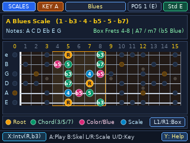
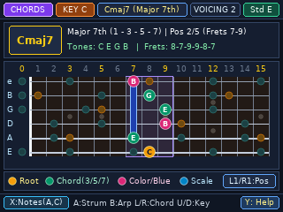
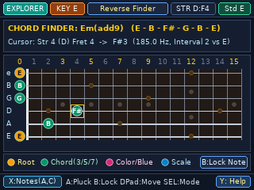
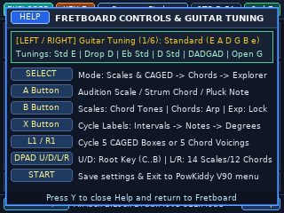

# Fretboard — Interactive Guitar Fretboard, CAGED Scale, Chord & Arpeggio Reference

A full-neck 15-fret interactive guitar encyclopedia (`320×240` RGB565, 6-voice fixed-point Karplus-Strong plucked-string synthesizer) for the **PowKiddy V90 / Q90** (`MiyooCFW 1.3.3`) and **Linux Desktop (`x86_64` X11 + ALSA)**.

---

## Screenshots

| Scales & CAGED Box View (`A Blues`, `POS 1`) | Chords & Arpeggios View (`Cmaj7`, `Voicing 2`) | Fret Explorer & Reverse Chord Finder (`Em(add9)`) | Help & 6 Guitar Tunings Modal (`Y`) |
| :---: | :---: | :---: | :---: |
|  |  |  |  |

---

## Features

- **Full-Width 15-Fret Hero Guitar Neck (`Frets 0–15`)**:
  - Color-coded anti-aliased note dots with crisp interior labels (`X` cycles between **Intervals `R, b3, 5`**, **Note Names `A, C, E`**, and **Scale Degrees / Finger Numbers**):
    - **Gold (`#F59E0B`)**: Root Note (`R` / `1`)
    - **Emerald Green (`#059669`)**: Chord-Tone Skeleton (`3`, `b3`, `5`, `7`, `b7`)
    - **Pink/Magenta (`#DB2777`)**: Characteristic Color / Blue Note (`b5` blue note, Dorian `6`, Lydian `#4`, Phrygian `b2`, Harmonic Minor `7`)
    - **Sky Cyan (`#0284C7`)**: Other Scale Tones (`2`, `4`, `6`)
    - **Dimmed Context Dots**: Shows out-of-box scale or arpeggio notes across the rest of the 15-fret neck so you can see how adjacent CAGED positions connect.
- **Three Interactive Modes (`SELECT` Button)**:
  1. **`SCALES & CAGED` Mode (Default)**:
     - **14 Guitar Scales & Modes**: `Minor Pentatonic`, `Blues Scale`, `Major Pentatonic`, `Natural Major (Ionian)`, `Natural Minor (Aeolian)`, `Dorian`, `Mixolydian`, `Lydian`, `Phrygian`, `Harmonic Minor`, `Melodic Minor`, `Phrygian Dominant`, `Locrian`, and `Whole-Half Diminished`.
     - **5 CAGED Positions + Full Neck (`L1` / `R1`)**: Step through `ALL NECK` $\rightarrow$ `POS 1 (E)` $\rightarrow$ `POS 2 (D)` $\rightarrow$ `POS 3 (C)` $\rightarrow$ `POS 4 (A)` $\rightarrow$ `POS 5 (G)`.
     - **Scale Audition (`A`)**: Plays the active CAGED box ascending across all 6 strings using a 6-voice Karplus-Strong guitar synthesizer while lighting up each plucked fret in real time.
  2. **`CHORDS & ARPEGGIOS` Mode**:
     - **12 Guitar Chord Qualities**: `Major`, `Minor`, `7`, `maj7`, `m7`, `m7b5`, `dim7`, `sus2`, `sus4`, `add9`, `6`, and `m6`.
     - **5 Playable CAGED Voicings Up the Neck (`L1` / `R1`)**: Displays playable 6-string voicings (with index-finger barre indicators and fret tabs) overlaid on the full-neck chord arpeggio (`B` toggles the full-neck arpeggio overlay).
     - **Realistic Guitar Strum (`A`)**: Strums the active 6-string chord voicing with a natural 32ms string-to-string pick stagger.
  3. **`FRET EXPLORER (Reverse Chord & Note Finder)` Mode**:
     - Move the cursor freely across all `6 strings × 16 frets (0..15)` with `DPAD` to inspect exact **Note + Octave** (`F#3`), **Frequency (`185.0 Hz`)**, and **Interval** against the key root.
     - Press **`B`** on any string/fret to lock or unlock a finger position; the **Reverse Chord Identifier** automatically names the locked chord (`Em(add9)`, `Cmaj7`, `G/B`, `D7sus4`, etc.) and press **`A`** to strum it.
- **6 Alternate Guitar Tunings (`Y` Help Modal)**:
  - `Standard (E A D G B e)`, `Drop D (D A D G B e)`, `Eb Standard`, `D Standard`, `DADGAD`, and `Open G`. Changing the tuning dynamically recalculates all scale maps, CAGED boxes, chord voicings, and string labels.

---

## Controls

| V90 Button | Linux Key | `SCALES & CAGED` Mode | `CHORDS & ARPEGGIOS` Mode | `FRET EXPLORER` Mode |
| :--- | :--- | :--- | :--- | :--- |
| **`SELECT`** | `Tab` | Switch Mode: `SCALES` $\rightarrow$ `CHORDS` $\rightarrow$ `EXPLORER` | Switch Mode: `CHORDS` $\rightarrow$ `EXPLORER` | Switch Mode: `EXPLORER` $\rightarrow$ `SCALES` |
| **`A`** | `Space` / `Z` | **Play / Audition** active CAGED scale box | **Strum** 6-string chord voicing | **Pluck** cursor note (or strum locked chord) |
| **`B`** | `X` / `BackSpace` | Toggle **Chord-Tone Skeleton** (`3/5/7`) | Toggle **Full-Neck Arpeggio** backdrop | **Lock / Unlock** finger on current string & fret |
| **`X`** | `C` | **Cycle Dot Labels**: `Intervals` $\rightarrow$ `Notes` $\rightarrow$ `Degrees` | **Cycle Dot Labels**: `Intervals` $\rightarrow$ `Notes` $\rightarrow$ `Fingers` | **Cycle Dot Labels**: `Intervals` $\rightarrow$ `Notes` $\rightarrow$ `Degrees` |
| **`Y`** | `V` / `H` | Toggle **Help & Guitar Tuning Modal** (`[L/R]` changes Tuning) | Toggle **Help & Guitar Tuning Modal** | Toggle **Help & Guitar Tuning Modal** |
| **`L1 / R1`** | `[` / `]` (or `-` / `=`) | Cycle **CAGED Box** (`ALL NECK`, `POS 1..5`) | Cycle **5 CAGED Chord Voicings** (`VOICING 1..5`) | Jump cursor `-3` / `+3` frets |
| **`DPAD UP / DOWN`** | `Up` / `Down` | Transpose **Root Key** (`C` .. `B`) | Transpose **Root Key** (`C` .. `B`) | Move cursor **Up / Down Strings** (`e` .. `E`) |
| **`DPAD LEFT / RIGHT`** | `Left` / `Right` | Cycle **14 Scales & Modes** | Cycle **12 Chord Qualities** | Move cursor **Left / Right Frets** (`0` .. `15`) |
| **`START`** | `Enter` / `Q` / `Esc` | Save state & **Exit** | Save state & **Exit** | Save state & **Exit** |

---

## Building

```bash
# Build both PowKiddy V90 ARM binary (fretboard) and Linux x86_64 binary (fretboard_linux)
make

# Run natively on Linux desktop (640x480 2x window + ALSA audio)
make run-linux

# Populate sdcard_package/ for the PowKiddy V90 'main' SD card partition
make package
```

### Installing on the PowKiddy V90

Copy the contents of `sdcard_package/` onto the `main` partition of your PowKiddy V90 MicroSD card (mounted at `/mnt` on the device):
- `sdcard_package/apps/fretboard/fretboard` $\rightarrow$ `/mnt/apps/fretboard/fretboard`
- `sdcard_package/apps/fretboard/icon.png` $\rightarrow$ `/mnt/apps/fretboard/icon.png`
- `sdcard_package/gmenu2x/sections/applications/fretboard` $\rightarrow$ `/mnt/gmenu2x/sections/applications/fretboard`
