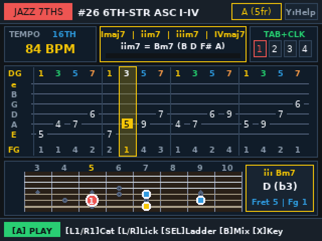
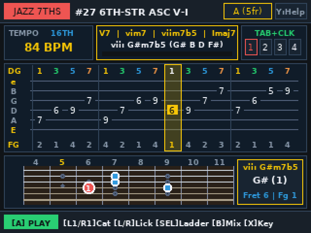
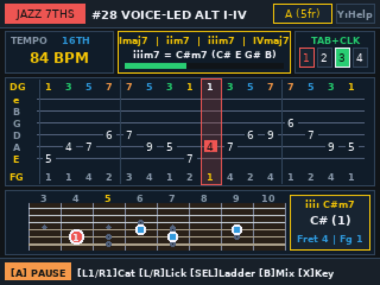

# Guitar Speed-Builder Practice Routine & Lick Coach (`licktrainer`)

An interactive **6-string guitar tab player, live fretboard position coach, and automated BPM speed-builder** for the **PowKiddy V90** handheld (`MiyooCFW 1.3.3`, `320×240` 16-bit RGB565 display, Allwinner F1C100S `ARM926EJ-S`) and **Linux Desktop (`x86_64` X11)**.

| Pentatonic Licks (`#05` Box 1 to 2 Slide) | Jazz 7ths Bar 1 (`#26` `I–ii–iii–IV`) | Jazz 7ths Bar 2 (`#27` `V7–vi–viim7b5–I`) | Voice-Led Alternating (`#28` `1-3-5-7` / `7-5-3-1`) |
| :---: | :---: | :---: | :---: |
|  |  |  |  |

---

## Key Features

- **33 Built-In Guitar Exercises Across 6 Categories (`L1` / `R1` to switch category, `LEFT` / `RIGHT` to pick lick)**:
  1. **`PENTATONIC` (`#01`–`#05`)**: *Gilbert 4-Note Seq*, *Eric Johnson 5s*, *Pentatonic Threes (12/8)*, *Wide String Skip*, *Box 1-to-2 Slide*.
  2. **`LEGATO/ARP` (`#06`–`#10`)**: *Legato 3-NPS Roll*, *Minor Triad Arp*, *Min7 Skipped Arp*, *Dim7 Symmetry Arp*, *5-Str Sweep Shape*.
  3. **`ALT PICK` (`#11`–`#15`)**: *Gilbert 3-NPS Cell*, *Neoclassic Pedal*, *Diatonic 4-Note*, *Di Meola Syncopa*, *Cross-String Jump*.
  4. **`BLUES/ROCK` (`#16`–`#20`)**: *BB & Albert Turn*, *SRV Texas Shuffle*, *Dorian Mixo Run*, *Hendrix Chord Embl*, *Blues b5 Cascade*.
  5. **`SPIDER` (`#21`–`#25`)**: *1-2-3-4 Spider*, *1-3-2-4 Permute*, *Skipping Spider*, *Diagonal Spider*, *4-3-2-1 Pinky Work*.
  6. **`JAZZ 7THS` (`#26`–`#33`)**: Consecutive Bar 1 & Bar 2 studies teaching diatonic `1–3–5–7` 7th chord arpeggios across every degree of the Major scale (`Imaj7`, `iim7`, `iiim7`, `IVmaj7`, `V7`, `vim7`, `viim7b5`):
     - **`#26` `6TH-STR ASC I-IV` & `#27` `6TH-STR ASC V-I`**: Ascending `1–3–5–7` arpeggios in 6th-string root position (`Imaj7 → iim7 → iiim7 → IVmaj7` and `V7 → vim7 → viim7b5 → Imaj7`).
     - **`#28` `VOICE-LED ALT I-IV` & `#29` `VOICE-LED ALT V-I`**: Jazz voice-leading drill alternating `1–3–5–7` ascending on odd chords and `7–5–3–1` descending on even chords.
     - **`#30` `UPPER-REG 7THS I-IV` & `#31` `UPPER-REG 7THS V-I`**: Upper-register (`D–G–B–e` string set) `1–3–5–7` diatonic 7th arpeggios.
     - **`#32` `CYCLE OF 4THS PT.1` & `#33` `CYCLE OF 4THS PT.2`**: Diatonic 7th arpeggios moving through the Jazz Cycle of Fourths (`Imaj7 → IVmaj7 → viim7b5 → iiim7` and `vim7 → iim7 → V7 → Imaj7`).
- **6-String Guitar Tab with Chord-Tone Degrees (`1, 3, 5, 7`), Picking & Left-Hand Fingerings**:
  - Displays a 12-step (triplet) or 16-step (16th-note) 6-string tab staff (`e B G D A E`) with a live highlighted step playhead.
  - **Chord-Tone Degree (`DG`) & Picking (`PK`) Row**: In `JAZZ 7THS` mode, displays the exact chord-tone degree (`1`, `3`, `5`, `7`) above every note and the 4-chord measure progression (`Imaj7 | iim7 | iiim7 | IVmaj7` or `V7 | vim7 | viim7b5 | Imaj7`) with spelled-out chord tones in the top banner. In standard lick categories, shows `D` (Downstroke), `U` (Upstroke), `H` (Hammer-on), `P` (Pull-off), and `/` (Slide).
  - **Left-Hand Finger Guide (`FG`)**: Shows recommended left-hand finger (`1` Index, `2` Middle, `3` Ring, `4` Pinky) below every note.
- **Live 6-String Guitar Neck Position & Active 4-Note Chord Arpeggio Highlight**:
  - Displays a zoomed 8-fret neck window centered on the exercise's active position. In `JAZZ 7THS` mode, highlights the active beat's 4-note chord arpeggio (`1–3–5–7`, with the chord root in gold and `3, 5, 7` in cyan) on top of faint scale dots, while the right readout card displays the active Roman numeral, chord symbol (e.g., `ii: Bm7`, `vii: G#m7b5`), and interval (`1`, `3`/`b3`, `5`/`b5`, `7`/`b7`).
- **Automated Speed-Builder BPM Ladder (`X`)**:
  - Cycle between `OFF (STATIC BPM)`, `+2 BPM / 2 BARS`, `+5 BPM / 4 BARS`, `+5 BPM / 8 BARS`, and `+10 BPM / 4 BARS` to automatically ramp up your picking speed as you repeat the loop.
- **Background-Thread Karplus-Strong Guitar Synth & Metronome (`B` to cycle mix)**:
  - Pre-synthesizes every step's plucked/legato guitar string waveform in a dedicated background worker thread (`synth_worker_thread_fn`) with atomic preemption so the UI never blocks when switching licks or transposing keys (`SELECT`).
  - Cycle audio mix between `TAB+CLK` (guitar synth + metronome click), `CLK ONLY` (metronome + visual cursor only), and `TAB ONLY`.

---

## Controls

| Action | PowKiddy V90 Button | Linux Desktop Key |
| :--- | :--- | :--- |
| **Play / Pause (with 4-beat count-in)** | **A** (`SDLK_LALT`) | `A`, `Return`, or `Left Alt` |
| **Cycle Audio Mix (`TAB+CLK` / `CLK ONLY` / `TAB ONLY`)** | **B** (`SDLK_LCTRL`) | `B` or `Left Ctrl` |
| **Cycle Speed-Builder Ladder (`OFF`, `+2/2b`, `+5/4b`, `+5/8b`, `+10/4b`)** | **SELECT** (`SDLK_ESCAPE`) | `C` or `Escape` |
| **Transpose Key / Neck Fret Position (`E..Eb`)** | **X** (`SDLK_LSHIFT`) | `X` or `Left Shift` |
| **Toggle Help & Practice Guide Overlay** | **Y** (`SDLK_SPACE`) | `Y`, `H`, or `Space` |
| **Previous / Next Category (`1..5`)** | **L1** / **R1** (`SDLK_TAB` / `SDLK_BACKSPACE`) | `Tab` / `Backspace`, `[` / `]`, or `PageUp` / `PageDown` |
| **Previous / Next Lick in Category** | **D-Pad LEFT** / **RIGHT** | `Left Arrow` / `Right Arrow` |
| **Increase / Decrease Tempo (`BPM`)** | **D-Pad UP** / **DOWN** | `Up Arrow` / `Down Arrow` |
| **Save Settings & Exit** | **MENU** (`SDLK_RCTRL`) | `Q` |

---

## Building & Running

```bash
# Build both the PowKiddy V90 ARM binary (licktrainer) and Linux x86_64 binary (licktrainer_linux)
make

# Launch on the Linux desktop
make run-linux

# Build the GMenu2X SD card package in ./sdcard_package/
make package
```

### Installing on PowKiddy V90 (MiyooCFW 1.3.3)
Copy the contents of `sdcard_package/` onto the `main` (`FAT32` `/mnt`) partition of your PowKiddy V90 MicroSD card:
- `sdcard_package/apps/licktrainer/licktrainer` $\rightarrow$ `/mnt/apps/licktrainer/licktrainer`
- `sdcard_package/apps/licktrainer/icon.png` $\rightarrow$ `/mnt/apps/licktrainer/icon.png`
- `sdcard_package/gmenu2x/sections/applications/licktrainer.lnk` $\rightarrow$ `/mnt/gmenu2x/sections/applications/licktrainer.lnk`
